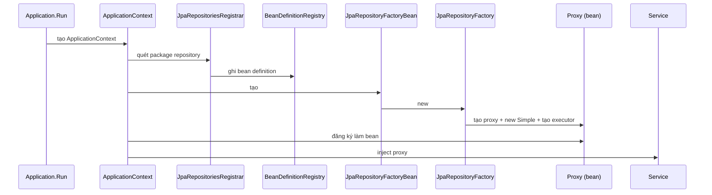
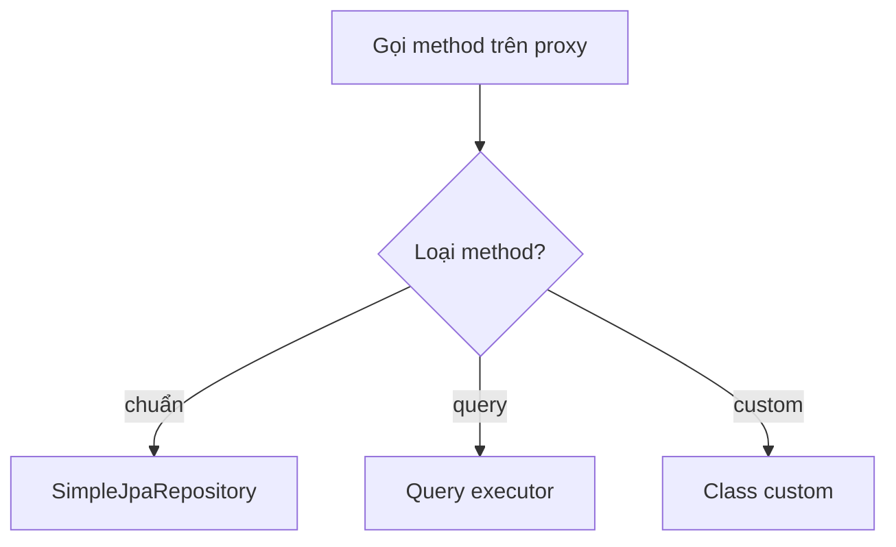

# Flow — Tầng Repository

Khởi động: Application.Run tạo ApplicationContext → JpaRepositoriesRegistrar quét package
repository, ghi bean definition vào BeanDefinitionRegistry → context tạo
JpaRepositoryFactoryBean → FactoryBean new JpaRepositoryFactory → Factory tạo proxy +
Simple + query executor → context đăng ký proxy làm bean → inject vào Service.

Proxy là cái ngã tư: mỗi method gọi tới sẽ rẽ một hướng khác nhau — method chuẩn rẽ sang
SimpleJpaRepository, method query rẽ sang bộ chạy query (suy từ tên method + annotation),
method custom rẽ sang class custom bạn tự viết (nếu có). Bản thân proxy không chứa code
làm việc thật nào.

### Sơ đồ khởi động

### Sơ đồ điều hướng lúc chạy

### Quy trình tổng (user tổng kết)

factory → tạo proxy + new SimpleJpaRepository → đưa proxy cho Spring container quản lý
(giờ gọi là bean) → Spring inject bean vào nơi cần → bean hoạt động bằng cách điều hướng
đến các target mà factory tạo ở trong (SimpleJpaRepository cho method chuẩn, bộ chạy query
cho method query).

[← Về note hub](02-tang-repository.md) | [← Về structure](structure.md)
