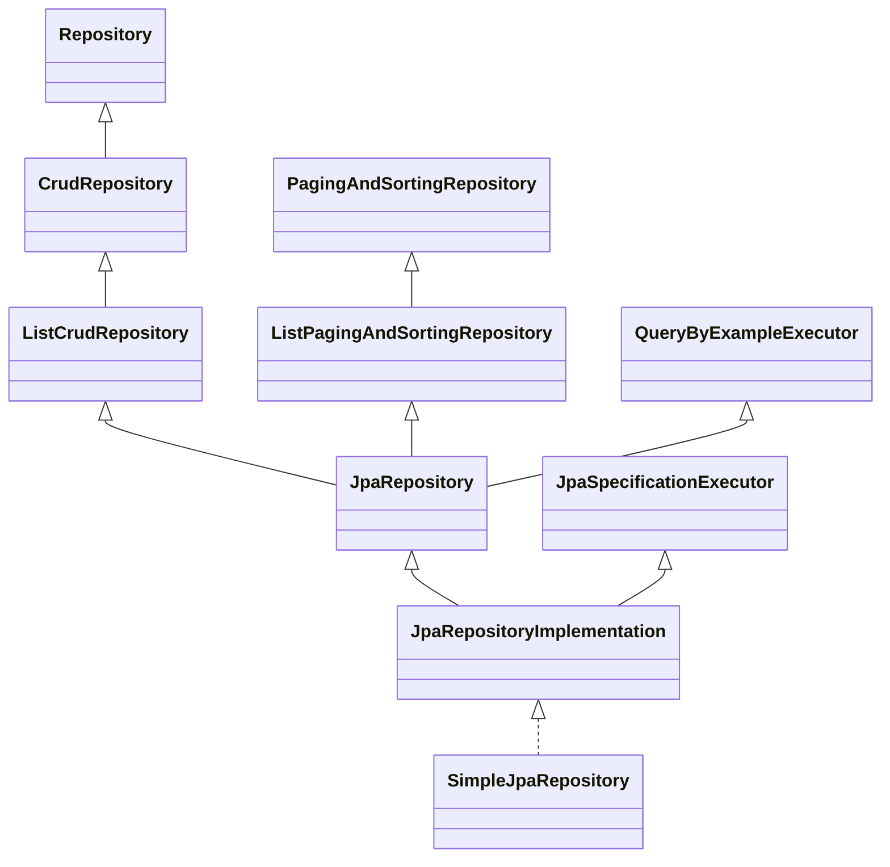

# Cấu trúc — Tầng Repository

Loại sơ đồ cho chủ đề này: Class Diagram (cây kế thừa) + sơ đồ cấu trúc tổng (bản vẽ tay của user).

## Navigation guide

Đọc theo thứ tự này:

1. **Cây kế thừa** trước — để biết các thành phần là gì: Repository chỉ là interface,
   SimpleJpaRepository là class viết sẵn giữ EntityManager.
2. **Proxy là bean** — để biết Spring chỉ biết tới proxy, Simple và query executor nằm
   bên trong proxy làm target, không phải bean riêng.
3. **Bản vẽ tay tổng thể** cuối — để thấy toàn cảnh từ Application.Run tới Database sau
   khi đã biết từng thành phần.

Đọc xong bản đồ thì đi [Flow](flow.md) để xem khởi động và điều hướng lúc runtime, hoặc
[Class phụ thuộc](classes.md) để xem vai trò từng thành phần. Khi một bước trong flow nhắc
tới thành phần chưa đặt được vị trí thì quay lại sơ đồ tổng thể ở đây.

## Cây kế thừa (Spring Data JPA 4.1.1, kiểm chứng bằng javap)

JpaRepository 4.1.1 KHÔNG kèm Specification — muốn dùng Specification phải extends thêm
JpaSpecificationExecutor. Ví dụ: OrderRepository extends cả JpaRepository<Order, Long> và
JpaSpecificationExecutor<Order>.

Bean Repository thực chất là proxy do Spring Data tạo, chuyển việc chuẩn cho
SimpleJpaRepository — class này giữ EntityManager, nối tầng Repository xuống tầng tiếp theo.

SimpleJpaRepository chỉ được new, không phải inject: JpaRepositoryFactory gọi new
SimpleJpaRepository(thông tin entity, entityManager) lúc app chạy. "Inject" chỉ dùng khi
Spring đưa một bean vào chỗ bạn xin nó (như proxy OrderRepository inject vào service) —
Simple thì bạn không bao giờ xin hay nhận. Chỗ duy nhất có inject ở đây là EntityManager
(Spring đưa nó vào factory, rồi factory đưa nó vào câu new).

Bean được Spring cầm đi inject CHÍNH LÀ proxy — SimpleJpaRepository instance nằm bên
trong proxy (làm target), đi kèm với proxy chứ không phải bean riêng. Spring chỉ biết
tới proxy, không biết tới Simple.

Sơ đồ cấu trúc tổng (bản vẽ tay của user):

Đào sâu theo từng khu vực: [Flow](flow.md) (khởi động và điều hướng lúc runtime),
[Class phụ thuộc](classes.md) (vai trò và quan hệ từng thành phần).

[← Về note hub](02-tang-repository.md)
