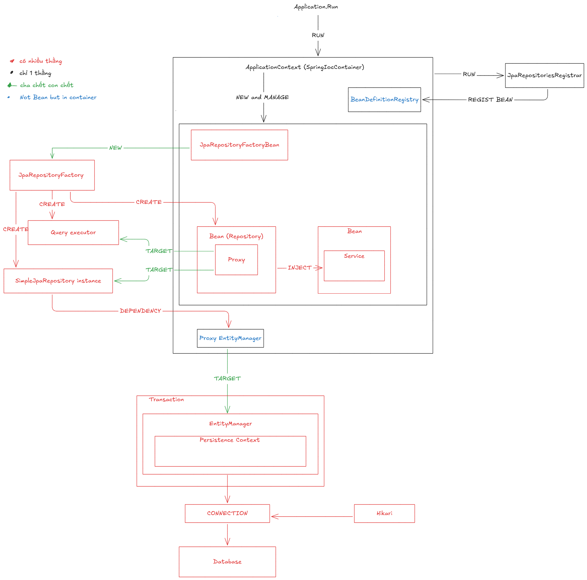

# Tầng EntityManager (JPA)

## Purpose

Code cần một "người quản lý" đứng giữa mình và database: thay vì tự viết SQL cho mọi
thao tác, code nói với EntityManager, nó lo theo dõi entity nào thay đổi rồi flush
xuống DB. JPA chuẩn hóa người quản lý này thành một API chung.

## Core idea

EntityManager là object trung tâm của JPA để quản lý entity: persist (lưu mới), find
(tìm theo id), merge, remove, query — và giữ Persistence Context (bộ nhớ đệm các entity
đang Managed).

## Mental model

Thứ bạn cầm không phải EntityManager thật mà là shared proxy: mỗi transaction có Session
thật riêng bên dưới, proxy chuyển tiếp đúng Session của transaction hiện tại. Session thật
đó giữ Persistence Context — bộ nhớ đệm các entity đang Managed.

## Structure map

Sơ đồ cho chủ đề này: sơ đồ cấu trúc tổng (bản vẽ tay của user).

Cấu trúc tầng này (đã chốt theo sơ đồ trên):

- Transaction chứa EntityManager; EntityManager chứa Persistence Context (cha chết con chết).
- Proxy EntityManager (trong container nhưng không phải bean) target tới EntityManager thật của transaction hiện tại.
- EntityManager dùng CONNECTION; Hikari cấp CONNECTION; CONNECTION tới Database.

## Deep dives

SimpleJpaRepository giữ một EntityManager (qua constructor) — đó là cầu nối từ tầng
Repository xuống tầng này. EntityManager quản lý Persistence Context: entity nào nó giữ
thì thành Managed, thay đổi trên Managed entity được dirty checking phát hiện và flush
xuống DB.

Đây mới là phần mở đầu — các phần đào sâu (vòng đời entity, Persistence Context, flush,
cascade) đang viết dở, sẽ điền vào file phần khi hoàn thiện.

## Ví dụ từ project study

SimpleJpaRepository(Order) giữ EntityManager; khi gọi save(order) → persist → entity
thành Managed trong Persistence Context.

## Key takeaways

- Tưởng EntityManager là connection tới DB — không phải, nó là API quản lý entity, nó
  DÙNG connection (qua Hibernate + JDBC) chứ không phải connection.
- Tưởng EntityManager dùng chung được giữa các thread — không, nó không thread-safe;
  trong Spring, shared proxy lo chuyển tiếp đúng Session theo transaction.
