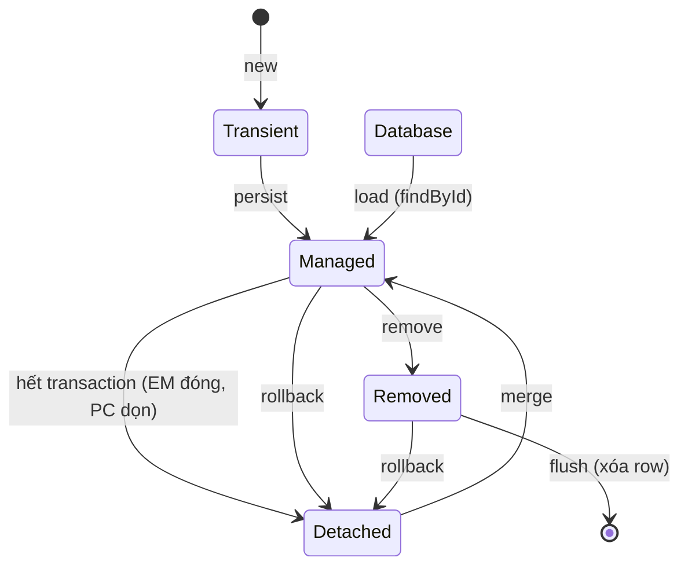
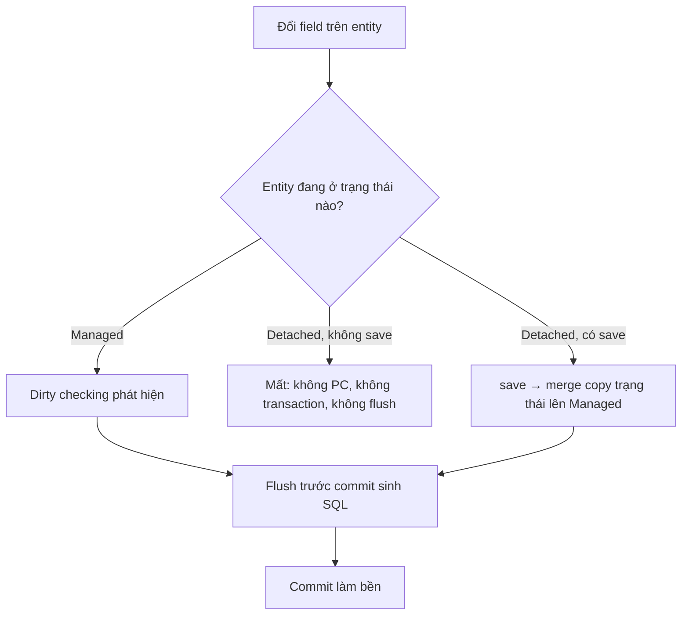
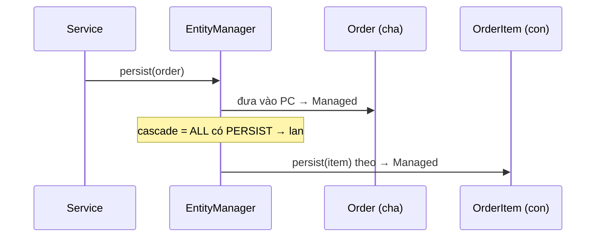

# Flow — Tầng EntityManager

## Vòng đời entity

Vòng đời của entity là quan hệ của nó với Persistence Context, không phải trạng thái của
row trong DB (trong DB chỉ có row, không có entity).

- **4 trạng thái:** Transient (chưa vào PC), Managed (đang trong PC), Detached (đã ra
  khỏi PC nhưng object còn đầy đủ dữ liệu trong RAM), Removed (đánh dấu hủy, chờ flush).
- **Vào Managed có 3 đường:** persist (entity mới), load (entity đã có trong DB — đây là
  mũi tên DB → Managed), merge (entity từ Detached về).
- **Ra khỏi Managed:** hết transaction (EM đóng, PC dọn) → Detached; remove → Removed.
- **Rollback** là hành động trên transaction, không phải trên trạng thái entity: nó hủy
  SQL đã flush + dọn PC, đưa Managed/Removed về Detached, không bao giờ về Transient;
  Transient thì chưa vào PC nên không có gì để rollback.

## Thay đổi xuống DB bằng cơ chế nào

Thay đổi trên entity chỉ xuống DB khi có cơ chế mang nó đi:

- Managed + không save → vẫn lưu (dirty checking lo).
- Detached + không save → mất.
- Detached + có save → lưu (merge → UPDATE lúc flush, bền lúc commit).
- Flush chạy TRƯỚC, commit SAU: commit là lần chốt bền đầu tiên và duy nhất; tách 2 bước
  để có điểm quyết định. `setSellPrice` chỉ đổi entity trong PC; UPDATE xuất hiện lúc
  flush trước commit, không phải lúc set.

## Cascade: thao tác lan theo danh sách

Cascade là danh sách thao tác được phép lan: thao tác nào có trong cascade thì khi thực
hiện trên thằng mang annotation sẽ lan sang thằng được tham chiếu; thao tác không có
trong danh sách thì không lan. Hướng lan là từ thằng mang cascade sang thằng được tham
chiếu; trong quan hệ cha–con thì thằng mang cascade là cha.

- Order.orderItemList cascade = ALL → persist/merge/remove trên Order đều lan sang
  OrderItem.
- Order → User không cascade → thao tác trên Order không lan sang User.
- Cascade chỉ đặt ở quan hệ cha–con thật (bài kiểm tra: "Xóa cha thì con có nên biến mất
  theo không?"). orphanRemoval KHÔNG phải CascadeType: nó kích hoạt khi con bị GỠ KHỎI
  COLLECTION, còn REMOVE kích hoạt khi remove(cha).

[← Về note hub](03-tang-entitymanager.md) | [← Về structure](structure.md) | [← Về thành phần](classes.md)
