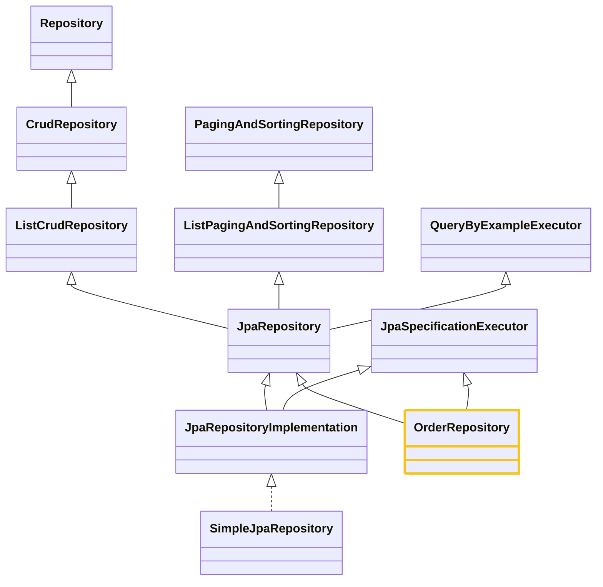

# Cấu trúc — Tầng Repository

Loại sơ đồ cho chủ đề này: Class Diagram (cây kế thừa) + sơ đồ cấu trúc tổng (bản vẽ tay của user).

## Cây kế thừa (Spring Data JPA 4.1.1, kiểm chứng bằng javap)

OrderRepository của bạn extends 2 interface: JpaRepository<Order, Long> và
JpaSpecificationExecutor<Order>. JpaRepository 4.1.1 KHÔNG kèm Specification — vì vậy muốn
dùng Specification phải extends thêm JpaSpecificationExecutor (như OrderRepository đã làm).

Bean Repository thực chất là proxy do Spring Data tạo, chuyển việc chuẩn cho
SimpleJpaRepository — class này giữ EntityManager, nối tầng Repository xuống tầng tiếp theo.

SimpleJpaRepository chỉ được new, không phải inject: JpaRepositoryFactory gọi new
SimpleJpaRepository(thông tin entity, entityManager) lúc app chạy. "Inject" chỉ dùng khi
Spring đưa một bean vào chỗ bạn xin nó (như proxy OrderRepository inject vào service) —
Simple thì bạn không bao giờ xin hay nhận. Chỗ duy nhất có inject ở đây là EntityManager
(Spring đưa nó vào factory, rồi factory đưa nó vào câu new).

Bean được Spring cầm đi inject CHÍNH LÀ proxy — SimpleJpaRepository instance nằm bên
trong proxy (làm target), đi kèm với proxy chứ không phải bean riêng. Spring chỉ biết
tới proxy, không biết tới Simple.

Sơ đồ cấu trúc tổng (bản vẽ tay của user):

[← Về note hub](../02-tang-repository.md)
