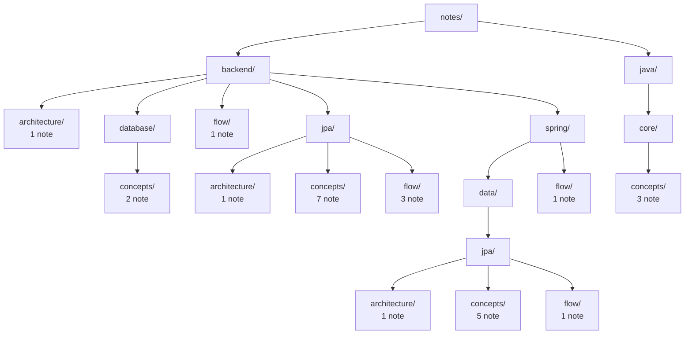

# Notes

<!-- tree:start -->
_Cây thư mục tự sinh, đừng sửa tay: `node tools/notes.js map`._

_Chú thích: mỗi ô là một thư mục; số note là số note nằm trực tiếp trong thư mục đó._
<!-- tree:end -->

- [java/core](java/core/concepts/README.md)
- [backend](backend/README.md)

Trong mỗi chủ đề có ba loại: `concepts` (note nguyên tử, là gì), `architecture` (cấu trúc tĩnh), `flow` (luồng chạy). Note xuyên nhiều chủ đề nằm ở thư mục cha chung của chúng.
