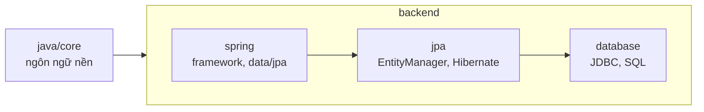

# Notes

- [java/core](java/core/concepts/README.md)
- [backend](backend/README.md)

Trong mỗi chủ đề có ba loại: `concepts` (note nguyên tử, là gì), `architecture` (cấu trúc tĩnh), `flow` (luồng chạy). Note xuyên nhiều chủ đề nằm ở thư mục cha chung của chúng.
