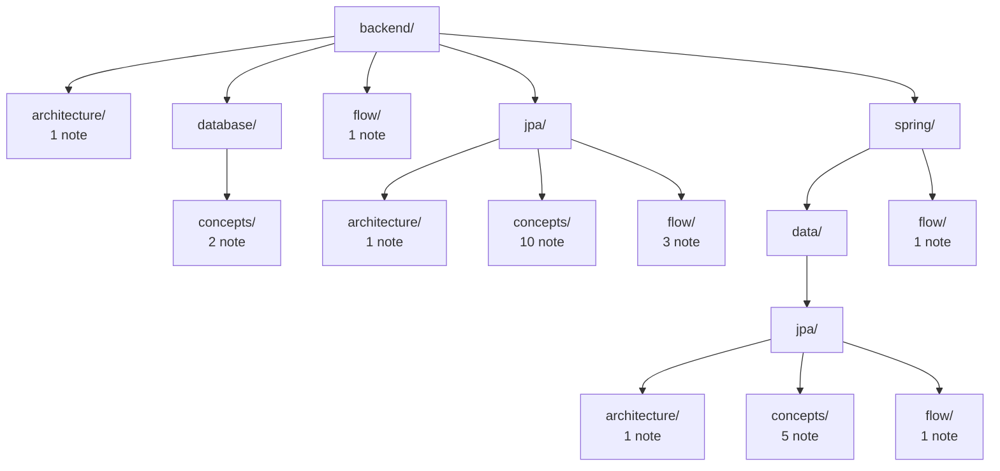

# Backend

Spring, JPA và database. Các bức tranh xuyên nhiều chủ đề nằm ngay ở đây.

<!-- tree:start -->
_Cây thư mục tự sinh, đừng sửa tay: `node tools/notes.js map`._

_Chú thích: mỗi ô là một thư mục; số note là số note nằm trực tiếp trong thư mục đó._
<!-- tree:end -->

- Cấu trúc: [architecture](architecture/README.md)
- Luồng: [flow](flow/README.md)
- Spring: [flow xuyên Spring](spring/flow/README.md) · [Spring Data JPA](spring/data/jpa/concepts/README.md)
- JPA: [concepts](jpa/concepts/README.md) · [architecture](jpa/architecture/README.md) · [flow](jpa/flow/README.md)
- Database: [concepts](database/concepts/README.md)
