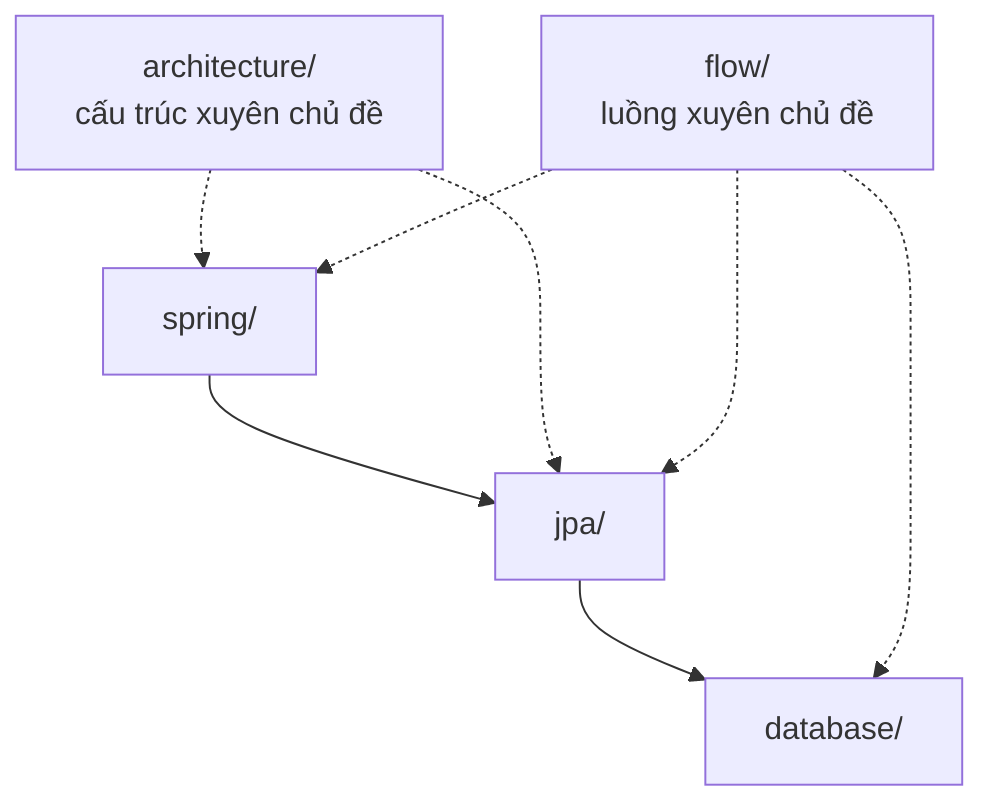

# Backend

Spring, JPA và database. Các bức tranh xuyên nhiều chủ đề nằm ngay ở đây.

- Cấu trúc: [architecture](architecture/README.md)
- Luồng: [flow](flow/README.md)
- Spring: [flow xuyên Spring](spring/flow/README.md) · [Spring Data JPA](spring/data/jpa/concepts/README.md)
- JPA: [concepts](jpa/concepts/README.md) · [architecture](jpa/architecture/README.md) · [flow](jpa/flow/README.md)
- Database: [concepts](database/concepts/README.md)
