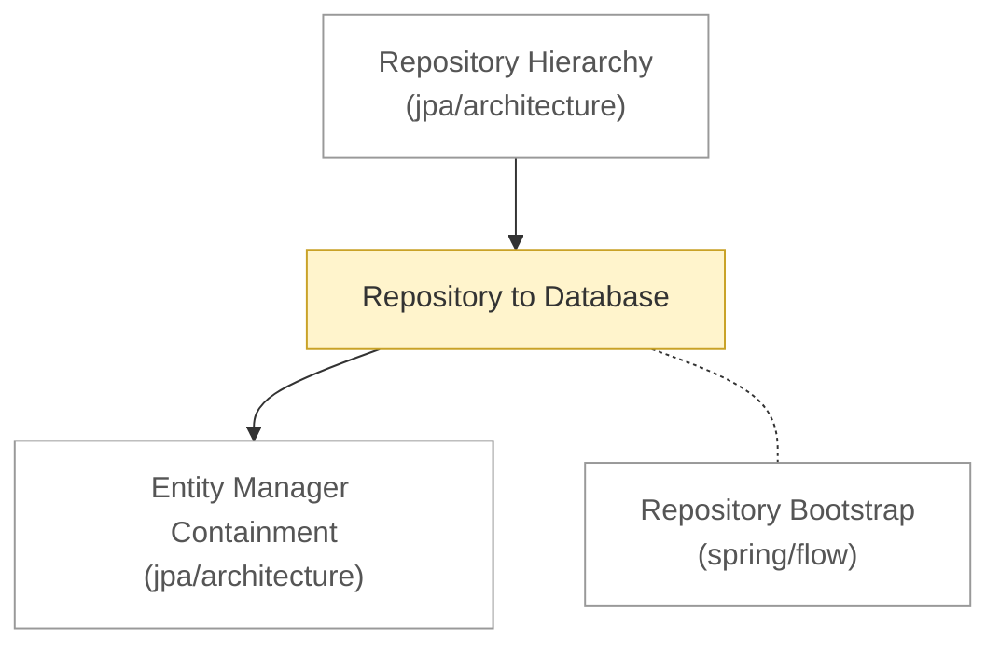

# Backend: architecture

<!-- map:start -->
_Sơ đồ tự sinh từ link trong các note, đừng sửa tay: `node tools/notes.js map`._

_Chú thích: mũi tên A → B: B là phần con hoặc chi tiết của A · nét đứt: liên quan ngang cấp, không có thứ tự · ô vàng: draft (đã viết, chưa chốt) · ô viền nhạt: note ở thư mục khác._
<!-- map:end -->

Cấu trúc tĩnh xuyên nhiều chủ đề (Spring, JPA, JDBC, database), không thuộc riêng chủ đề nào.

1. [Repository to Database](repository-to-database.md): từ Application.Run tới Database

Theo từng chủ đề: [Spring Data JPA](../spring/data/jpa/architecture/README.md) · [JPA](../jpa/architecture/README.md)
