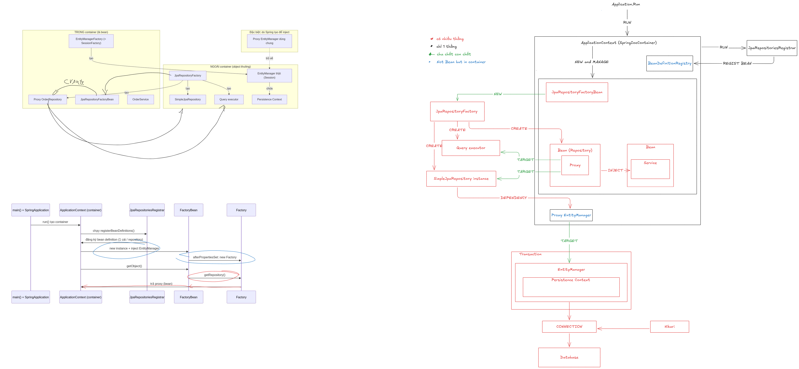
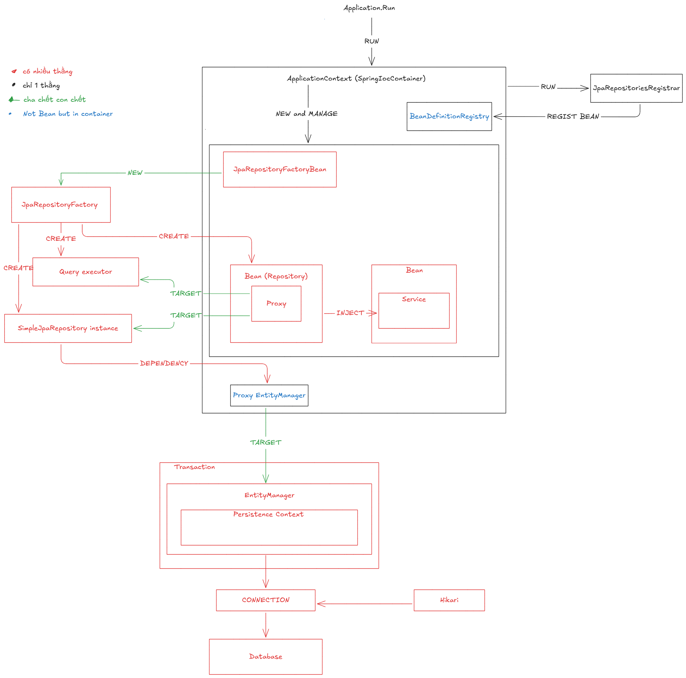
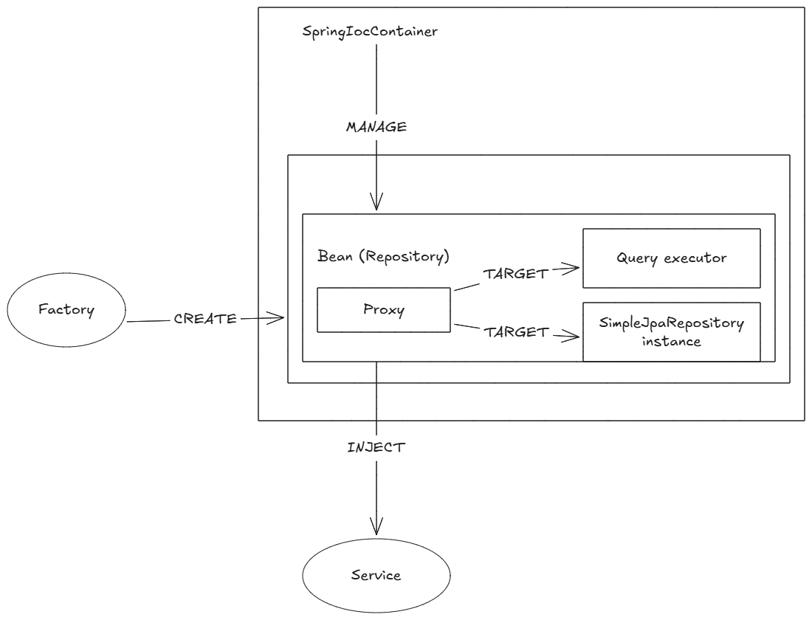

**Một câu:** FactoryBean tạo Factory, Factory tạo ra proxy cùng SimpleJpaRepository cùng query executor; lúc chạy chỉ có proxy là bean, các thứ còn lại nằm bên trong nó.

## Bản vẽ tay (từ Application.Run tới Database)
Sơ đồ mới nhất, gồm ba hình: cấu trúc trong/ngoài container, flow khởi động, kiến trúc tổng:

Nguồn chỉnh sửa: [spring-data-architecture.excalidraw](assets/spring-data-architecture.excalidraw). Hai bản vẽ tay cũ:

## Ký hiệu quan hệ
| Ký hiệu | Nghĩa |
|---|---|
| CHỨA (◆) | cha chết con chết |
| TẠO | một thành phần `new` hoặc sinh ra thành phần khác |
| DEPENDENCY | giữ reference và gọi method |
| INJECT | container đưa bean vào chỗ xin |
| TARGET | proxy ủy thác cho |

## Thành phần chính
- `JpaRepositoryFactoryBean` (bean) `new` `JpaRepositoryFactory` và chứa nó; container gọi `getObject()` để lấy proxy.
- `JpaRepositoryFactory` tạo [proxy](../spring/data/jpa/concepts/repository-proxy.md), `new` [SimpleJpaRepository](../spring/data/jpa/concepts/simple-jpa-repository.md), tạo [query executor](../spring/data/jpa/concepts/query-executor.md).
- `Proxy EntityManager` target tới EntityManager thật của transaction hiện tại, xem [Entity Manager Containment](../jpa/architecture/entity-manager-containment.md).

## Liên kết
- **Nền:** [Repository Hierarchy](../spring/data/jpa/architecture/repository-hierarchy.md)
- **Flow:** [Repository Bootstrap](../spring/flow/repository-bootstrap.md)
- **Sâu hơn (tầng dưới):** [Entity Manager Containment](../jpa/architecture/entity-manager-containment.md)
