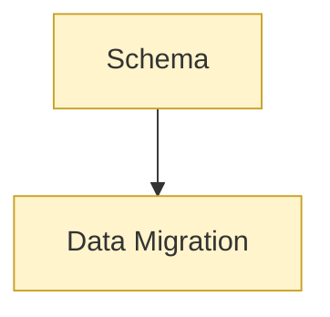

# Database: concepts

<!-- map:start -->
_Sơ đồ tự sinh từ link trong các note, đừng sửa tay: `node tools/notes.js map`._

_Chú thích: mũi tên A → B: B là phần con hoặc chi tiết của A · ô vàng: draft (đã viết, chưa chốt)._
<!-- map:end -->

1. [Schema](schema.md)
2. [Data Migration](data-migration.md)
