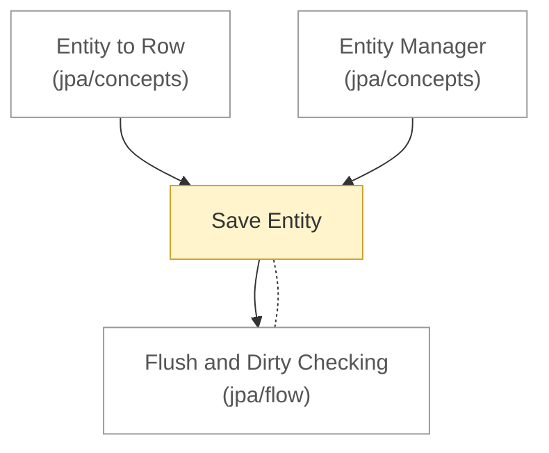

# Backend: flow

<!-- map:start -->
_Sơ đồ tự sinh từ link trong các note, đừng sửa tay: `node tools/notes.js map`._

<!-- map:end -->

Luồng chạy xuyên nhiều chủ đề (Spring, JPA, Hibernate, JDBC, database), không thuộc riêng chủ đề nào.

1. [Save Entity](save-entity.md): một lệnh lưu đi qua các tầng

Theo từng chủ đề: [Spring](../spring/flow/README.md) · [Spring Data JPA](../spring/data/jpa/flow/README.md) · [JPA](../jpa/flow/README.md)
