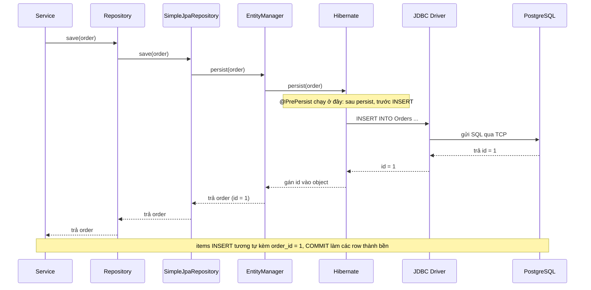

**Một câu:** Một lệnh lưu đi xuống qua các tầng từ Service tới PostgreSQL rồi quay ngược lại.

## Ví dụ
[`@PrePersist`](../jpa/glossary.md#prepersist) chạy sau persist và trước INSERT nên `createdAt` đã có giá trị trước khi vào câu INSERT. Với id [IDENTITY](../jpa/glossary.md#identity), INSERT chạy ngay lúc persist.

## Liên kết
- **Nền:** [Entity to Row](../jpa/concepts/entity-to-row.md) · [Entity Manager](../jpa/concepts/entity-manager.md)
- **Sâu hơn:** [Flush and Dirty Checking](../jpa/flow/flush-and-dirty-checking.md)
- **Bên cạnh:** [Repository Dispatch](../spring/data/jpa/flow/repository-dispatch.md)
