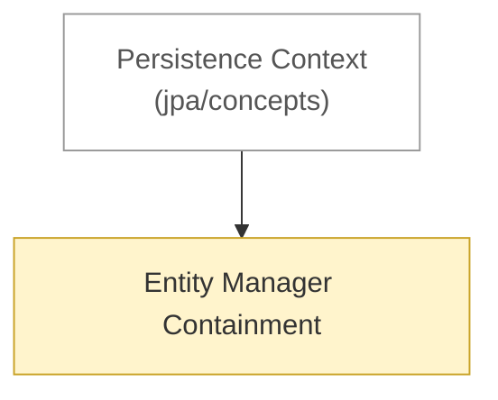

# JPA: architecture

<!-- map:start -->
_Sơ đồ tự sinh từ link trong các note, đừng sửa tay: `node tools/notes.js map`._

_Chú thích: mũi tên A → B: B là phần con hoặc chi tiết của A · ô vàng: draft (đã viết, chưa chốt) · ô viền nhạt: note ở thư mục khác._
<!-- map:end -->

1. [Entity Manager Containment](entity-manager-containment.md) — ai chứa ai, ai target ai

Xem thêm: [concepts](../concepts/README.md) · [flow](../flow/README.md)
