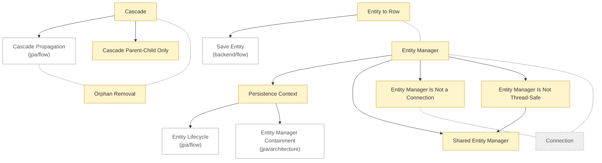

# JPA: concepts

<!-- map:start -->
_Sơ đồ tự sinh từ link trong các note, đừng sửa tay: `node tools/notes.js map`._

_Chú thích: mũi tên A → B: B là phần con hoặc chi tiết của A · nét đứt: liên quan ngang cấp, không có thứ tự · ô vàng: draft (đã viết, chưa chốt) · ô xám nét đứt: stub (chưa học) · ô viền nhạt: note ở thư mục khác._
<!-- map:end -->

Cần biết trước: [Polymorphism](../../../java/core/concepts/polymorphism.md).

1. [Entity to Row](entity-to-row.md)
2. [Entity Manager](entity-manager.md)
3. [Persistence Context](persistence-context.md)
4. [Shared Entity Manager](shared-entity-manager.md)
5. [Entity Manager Is Not a Connection](entity-manager-is-not-connection.md)
6. [Entity Manager Is Not Thread-Safe](entity-manager-is-not-thread-safe.md)
7. [Cascade](cascade.md)
8. [Cascade Parent-Child Only](cascade-parent-child-only.md)
9. [Orphan Removal](orphan-removal.md)
10. [Connection](connection.md): stub

Xem thêm: [architecture](../architecture/README.md) · [flow](../flow/README.md)

Thuật ngữ: [glossary](../glossary.md)
