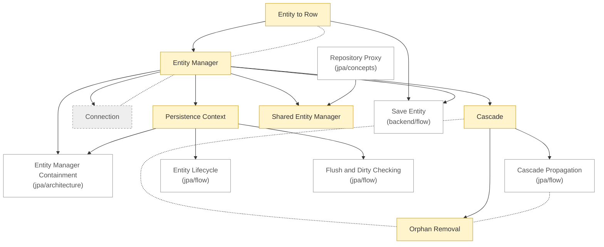

# JPA: concepts

<!-- map:start -->
_Sơ đồ tự sinh từ link trong các note, đừng sửa tay: `node tools/notes.js map`._

<!-- map:end -->

Cần biết trước: [Polymorphism](../../../java/core/concepts/polymorphism.md).

1. [Entity to Row](entity-to-row.md)
2. [Entity Manager](entity-manager.md)
3. [Persistence Context](persistence-context.md)
4. [Shared Entity Manager](shared-entity-manager.md)
5. [Cascade](cascade.md)
6. [Orphan Removal](orphan-removal.md)
7. [Connection](connection.md): stub

Xem thêm: [architecture](../architecture/README.md) · [flow](../flow/README.md)
