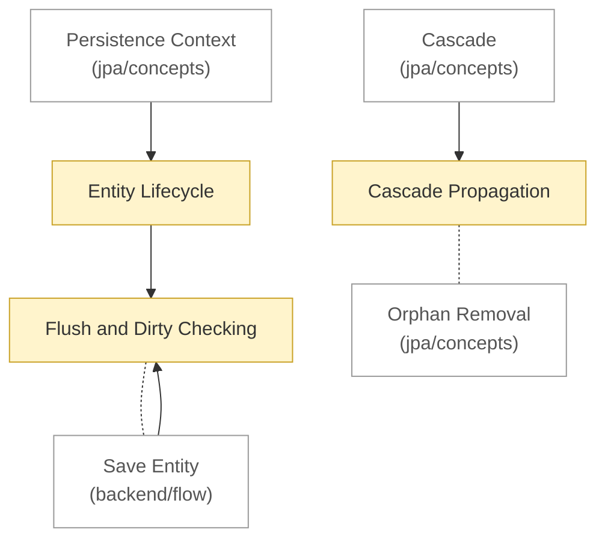

# JPA: flow

<!-- map:start -->
_Sơ đồ tự sinh từ link trong các note, đừng sửa tay: `node tools/notes.js map`._

_Chú thích: mũi tên A → B: B là phần con hoặc chi tiết của A · nét đứt: liên quan ngang cấp, không có thứ tự · ô vàng: draft (đã viết, chưa chốt) · ô viền nhạt: note ở thư mục khác._
<!-- map:end -->

Luồng chạy chỉ trong phạm vi JPA. Thứ tự đọc:

1. [Entity Lifecycle](entity-lifecycle.md): bốn trạng thái của entity
2. [Flush and Dirty Checking](flush-and-dirty-checking.md): thay đổi xuống DB bằng cơ chế nào
3. [Cascade Propagation](cascade-propagation.md): thao tác lan từ cha sang con

Xem thêm: [concepts](../concepts/README.md) · [architecture](../architecture/README.md) · [một lệnh lưu đi qua các tầng](../../flow/README.md)

Thuật ngữ: [glossary](../glossary.md)
