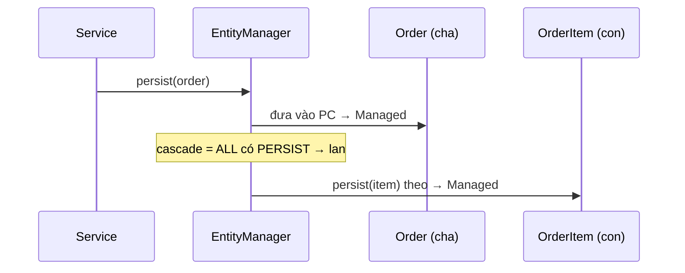

**Một câu:** Thao tác nào có trong danh sách cascade thì lan từ cha sang con khi thực hiện trên cha.

## Liên kết
- **Nền:** [Cascade](../concepts/cascade.md) · [Entity Lifecycle](entity-lifecycle.md)
- **Bên cạnh:** [Orphan Removal](../concepts/orphan-removal.md)
