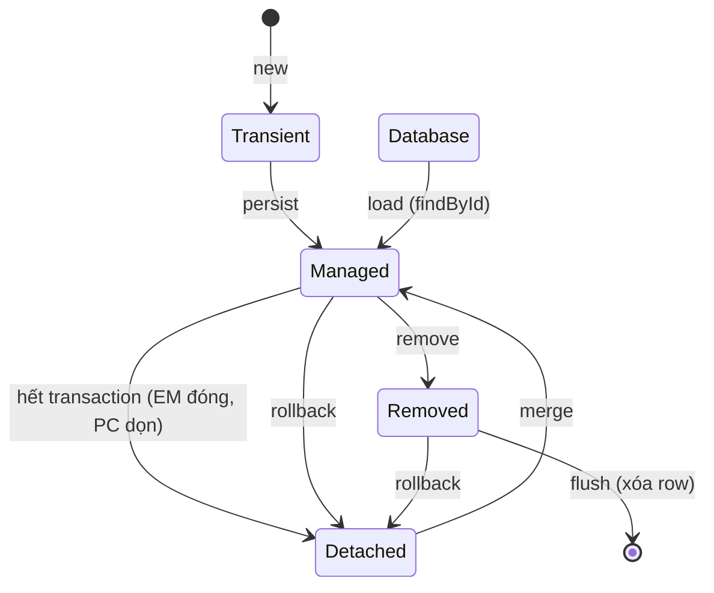

**Một câu:** Vòng đời của entity là quan hệ của nó với [Persistence Context](../glossary.md#persistence-context), không phải trạng thái của row trong DB.

## Liên kết
- **Nền:** [Persistence Context](../concepts/persistence-context.md)
- **Sâu hơn:** [Flush and Dirty Checking](flush-and-dirty-checking.md)
