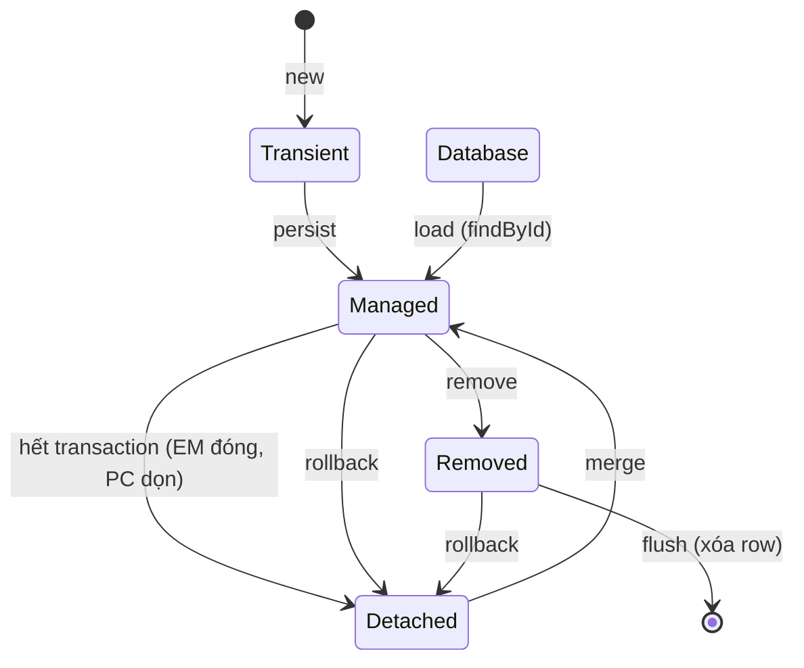

**Một câu:** Vòng đời của entity là quan hệ của nó với Persistence Context, không phải trạng thái của row trong DB.

## Giải thích
- **4 trạng thái:** Transient (chưa vào PC), Managed (đang trong PC), Detached (đã ra khỏi PC nhưng object còn đủ dữ liệu trong RAM), Removed (đánh dấu hủy, chờ flush).
- **Vào Managed có 3 đường:** persist (entity mới), load (entity đã có trong DB), merge (từ Detached về).
- **Ra khỏi Managed:** hết transaction thì thành Detached, remove thì thành Removed.
- **Rollback** là hành động trên transaction, không phải trên trạng thái entity: nó hủy SQL đã flush và dọn PC, đưa Managed/Removed về Detached, không bao giờ về Transient (Transient chưa vào PC nên không có gì để rollback).

## Liên kết
- **Nền:** [Persistence Context](../concepts/persistence-context.md)
- **Sâu hơn:** [Flush and Dirty Checking](flush-and-dirty-checking.md)
