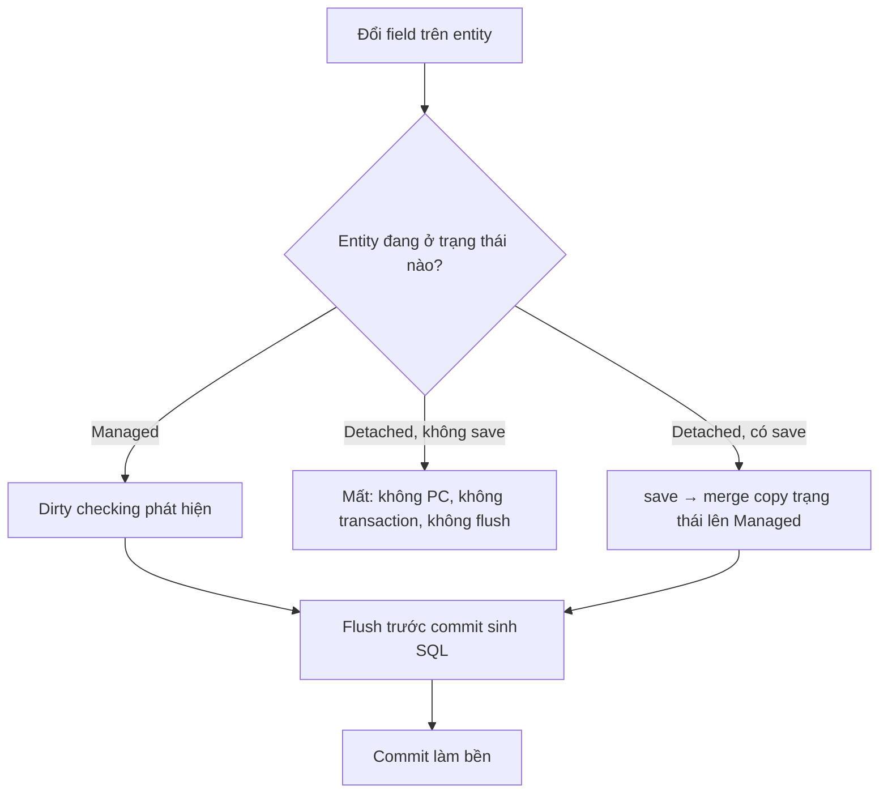

**Một câu:** Thay đổi trên entity chỉ xuống DB khi có cơ chế mang nó đi: [Managed](../glossary.md#managed) thì [dirty checking](../glossary.md#dirty-checking) lo, [Detached](../glossary.md#detached) thì chỉ [save](../glossary.md#merge) (merge) mới mang được.

## Giải thích
- Managed, không save: vẫn lưu (dirty checking lo).
- Detached, không save: mất.
- Detached, có save: lưu (merge → UPDATE lúc flush, bền lúc commit).
- Flush chạy TRƯỚC, commit SAU. Commit là lần chốt bền đầu tiên và duy nhất, tách hai bước để có điểm quyết định. `setSellPrice` chỉ đổi entity trong PC; UPDATE xuất hiện lúc flush trước commit, không phải lúc set.

## Liên kết
- **Nền:** [Entity Lifecycle](entity-lifecycle.md) · [Persistence Context](../concepts/persistence-context.md)
- **Bên cạnh:** [Save Entity](../../flow/save-entity.md)
