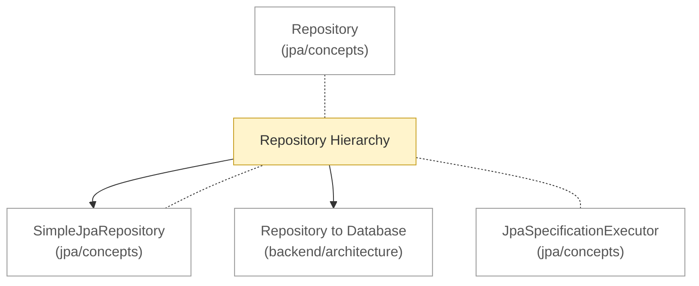

# Spring Data JPA: architecture

<!-- map:start -->
_Sơ đồ tự sinh từ link trong các note, đừng sửa tay: `node tools/notes.js map`._

_Chú thích: mũi tên A → B: B là phần con hoặc chi tiết của A · nét đứt: liên quan ngang cấp, không có thứ tự · ô vàng: draft (đã viết, chưa chốt) · ô viền nhạt: note ở thư mục khác._
<!-- map:end -->

Cấu trúc tĩnh, chỉ trong phạm vi Spring Data JPA. Thứ tự đọc:

1. [Repository Hierarchy](repository-hierarchy.md): cây kế thừa

Xem thêm: [concepts](../concepts/README.md) · [flow](../flow/README.md) · [bức tranh xuyên backend](../../../../architecture/README.md)
