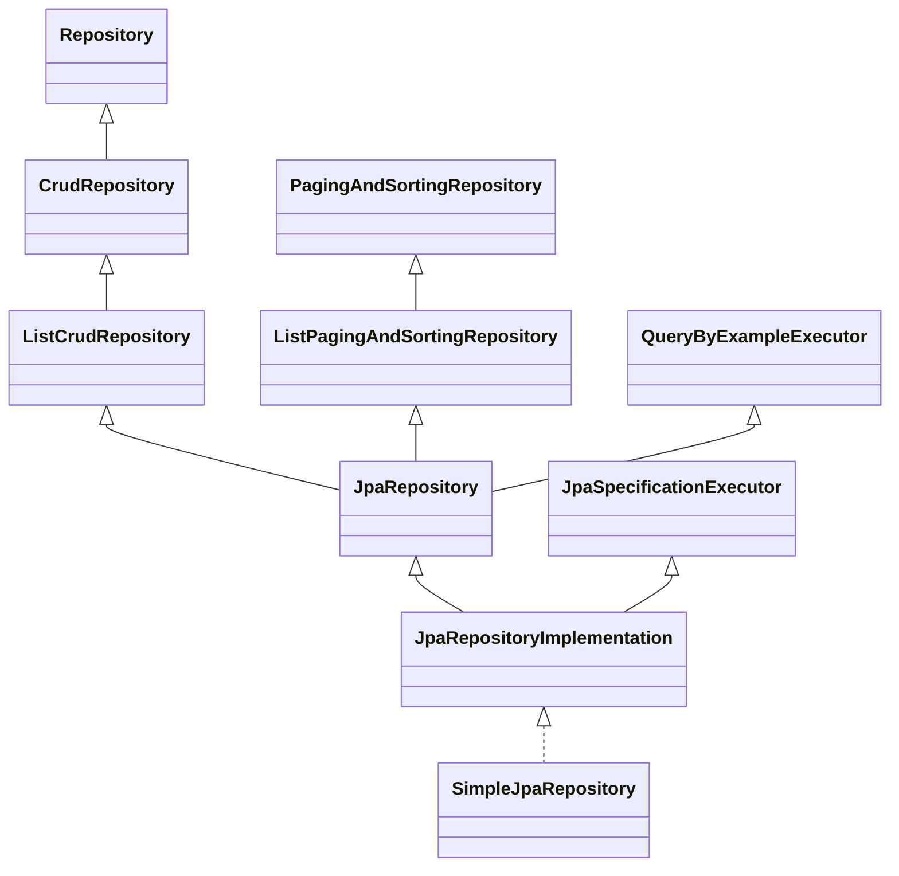

**Một câu:** SimpleJpaRepository nằm ở đáy cây kế thừa của Spring Data JPA, implements JpaRepositoryImplementation (gom JpaRepository với JpaSpecificationExecutor).

## Cây kế thừa

## Giải thích
- `JpaRepository` gom `ListCrudRepository`, `ListPagingAndSortingRepository`, `QueryByExampleExecutor` và method riêng của JPA (`flush`, `saveAndFlush`...).
- `JpaRepository` 4.1.1 **không** kèm Specification: xem [JpaSpecificationExecutor](../concepts/jpa-specification-executor.md).
- Ví dụ: `OrderRepository extends JpaRepository<Order, Long>, JpaSpecificationExecutor<Order>`.

## Liên kết
- **Nền:** [Repository](../concepts/repository.md)
- **Sâu hơn:** [SimpleJpaRepository](../concepts/simple-jpa-repository.md) · [Repository to Database](../../../../architecture/repository-to-database.md)
