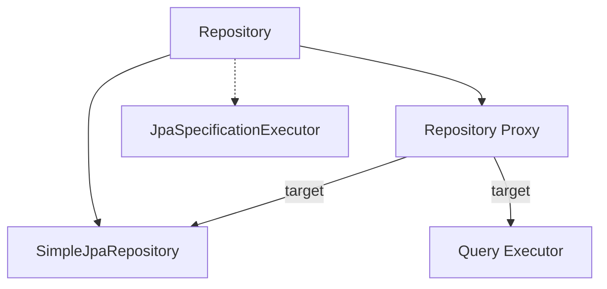

# Spring Data JPA: concepts

Cần biết trước: [Polymorphism](../../../../../java/core/concepts/polymorphism.md).

1. [Repository](repository.md)
2. [SimpleJpaRepository](simple-jpa-repository.md)
3. [Repository Proxy](repository-proxy.md)
4. [Query Executor](query-executor.md)
5. [JpaSpecificationExecutor](jpa-specification-executor.md)

Xem thêm: [architecture](../architecture/README.md) · [flow](../flow/README.md)
