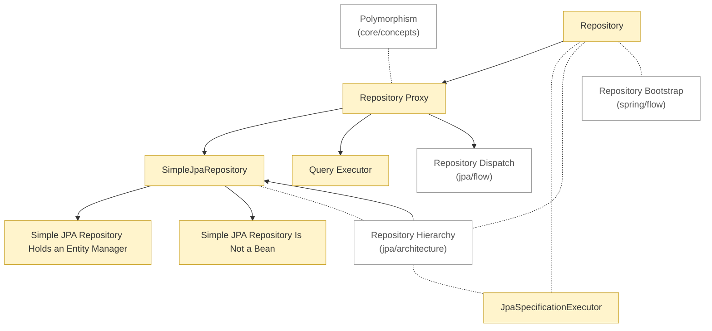

# Spring Data JPA: concepts

<!-- map:start -->
_Sơ đồ tự sinh từ link trong các note, đừng sửa tay: `node tools/notes.js map`._

_Chú thích: mũi tên A → B: B là phần con hoặc chi tiết của A · nét đứt: liên quan ngang cấp, không có thứ tự · ô vàng: draft (đã viết, chưa chốt) · ô viền nhạt: note ở thư mục khác._
<!-- map:end -->

Cần biết trước: [Polymorphism](../../../../../java/core/concepts/polymorphism.md).

1. [Repository](repository.md)
2. [SimpleJpaRepository](simple-jpa-repository.md)
3. [Repository Proxy](repository-proxy.md)
4. [Query Executor](query-executor.md)
5. [JpaSpecificationExecutor](jpa-specification-executor.md)
6. [Simple JPA Repository Holds an Entity Manager](simple-jpa-repository-holds-an-entity-manager.md)
7. [Simple JPA Repository Is Not a Bean](simple-jpa-repository-is-not-a-bean.md)

Xem thêm: [architecture](../architecture/README.md) · [flow](../flow/README.md)
