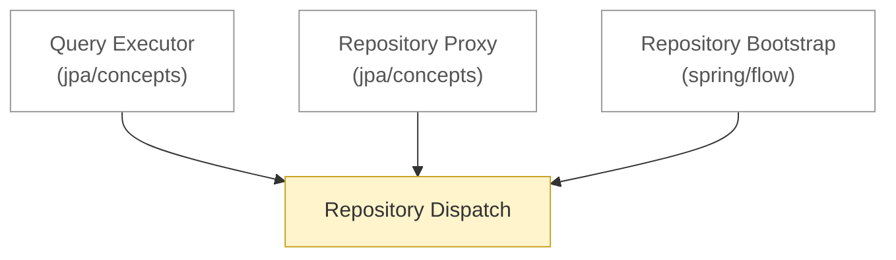

# Spring Data JPA: flow

<!-- map:start -->
_Sơ đồ tự sinh từ link trong các note, đừng sửa tay: `node tools/notes.js map`._

_Chú thích: mũi tên A → B: B là phần con hoặc chi tiết của A · ô vàng: draft (đã viết, chưa chốt) · ô viền nhạt: note ở thư mục khác._
<!-- map:end -->

Luồng chạy chỉ trong phạm vi Spring Data JPA. Thứ tự đọc:

1. [Repository Dispatch](repository-dispatch.md): lúc chạy, một lời gọi rẽ đi đâu

Xem thêm: [concepts](../concepts/README.md) · [architecture](../architecture/README.md) · [khởi động (xuyên Spring)](../../../flow/README.md) · [xuyên backend](../../../../flow/README.md)
