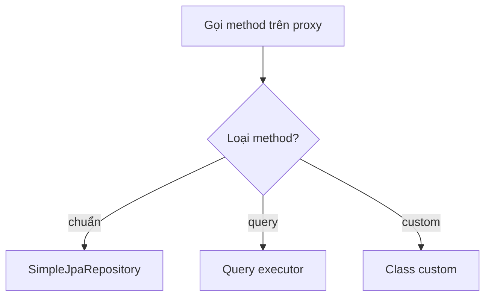

**Một câu:** Proxy là cái ngã tư: method chuẩn rẽ sang SimpleJpaRepository, method query rẽ sang query executor, method custom rẽ sang class custom của ta.

## Sơ đồ điều hướng lúc chạy

Bản thân proxy không chứa code làm việc thật nào.

## Liên kết
- **Nền:** [Repository Proxy](../concepts/repository-proxy.md) · [Repository Bootstrap](../../../flow/repository-bootstrap.md)
- **Sâu hơn:** [SimpleJpaRepository](../concepts/simple-jpa-repository.md) · [Query Executor](../concepts/query-executor.md)
