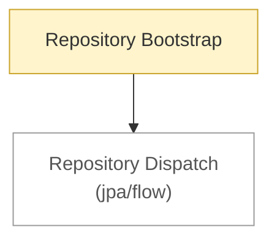

# Spring: flow

<!-- map:start -->
_Sơ đồ tự sinh từ link trong các note, đừng sửa tay: `node tools/notes.js map`._

_Chú thích: mũi tên A → B: B là phần con hoặc chi tiết của A · ô vàng: draft (đã viết, chưa chốt) · ô viền nhạt: note ở thư mục khác._
<!-- map:end -->

Luồng chạy xuyên nhiều dự án Spring (Framework và Data).

1. [Repository Bootstrap](repository-bootstrap.md): khởi động, từ Application.Run tới bean repository

Xem thêm: [Spring Data JPA](../data/jpa/flow/README.md) · [xuyên backend](../../flow/README.md)
