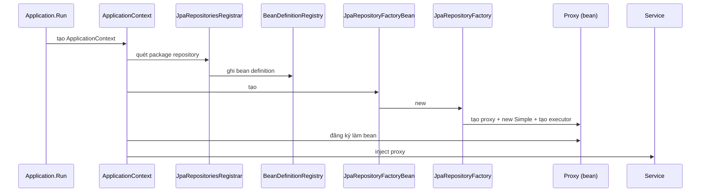

**Một câu:** Factory tạo proxy cùng SimpleJpaRepository, proxy được đưa cho Spring container quản lý thành bean, Spring inject bean vào nơi cần, bean hoạt động bằng cách điều hướng tới các target mà factory tạo bên trong.

## Sơ đồ khởi động

## Liên kết
- **Nền:** [Repository Proxy](../data/jpa/concepts/repository-proxy.md)
- **Sâu hơn:** [Repository Dispatch](../data/jpa/flow/repository-dispatch.md)
- **Bên cạnh:** [Repository to Database](../../architecture/repository-to-database.md)
