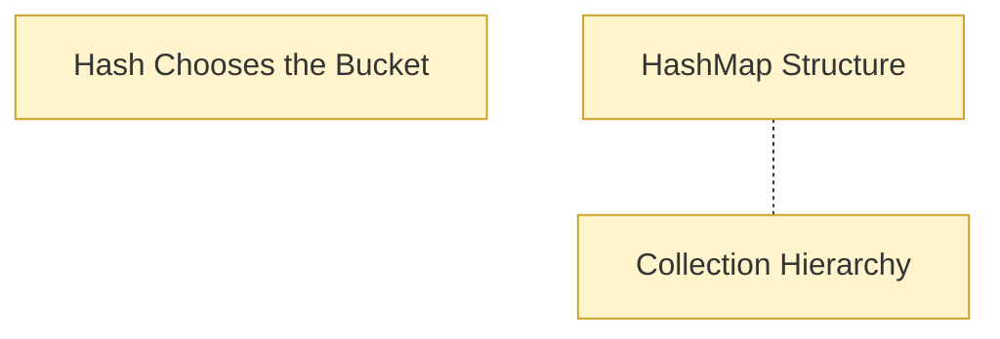

# collections: architecture

<!-- map:start -->
_Sơ đồ tự sinh từ link trong các note, đừng sửa tay: `node tools/notes.js map`._

_Chú thích: nét đứt: liên quan ngang cấp, không có thứ tự · ô vàng: draft (đã viết, chưa chốt)._
<!-- map:end -->

1. [Collection Hierarchy](collection-hierarchy.md)
2. [HashMap Structure](hashmap-structure.md)
3. [Hash Chooses the Bucket](hash-chooses-the-bucket.md)
