# collections: concepts

<!-- map:start -->
_Sơ đồ tự sinh từ link trong các note, đừng sửa tay: `node tools/notes.js map`._

```mermaid
flowchart TD
    n0["ArrayList Grows by Copying"]:::draft
    n1["ArrayList Has No Gaps"]:::draft
    n2["ArrayList Is Not Just a Resizable Array"]:::draft
    n3["ArrayList Size vs Capacity"]:::draft
    n4["Comparable Lives in the Class"]:::draft
    n5["Comparator from a Key"]:::draft
    n6["Comparator Lives Outside the Class"]:::draft
    n7["Equals and HashCode Contract"]:::draft
    n8["HashMap Needs a Raw Array"]:::draft
    n9["LinkedHashMap Order"]:::draft
    n10["Map Duplicate Key Policy"]:::draft
    n11["HashMap Put and Get<br/>(collections/flow)"]:::ext
    n6 -.- n4
    n11 -.- n7
    classDef stub fill:#eeeeee,stroke:#999999,stroke-dasharray:4 3,color:#555555
    classDef draft fill:#fff4cc,stroke:#c9a227,color:#333333
    classDef ok fill:#d8f0dc,stroke:#3a9d5d,color:#222222
    classDef ext fill:#ffffff,stroke:#999999,color:#555555
```

_Chú thích: nét đứt: liên quan ngang cấp, không có thứ tự · ô vàng: draft (đã viết, chưa chốt) · ô viền nhạt: note ở thư mục khác._
<!-- map:end -->

1. [ArrayList Is Not Just a Resizable Array](arraylist-is-not-just-a-resizable-array.md)
2. [ArrayList Has No Gaps](arraylist-has-no-gaps.md)
3. [HashMap Needs a Raw Array](hashmap-needs-a-raw-array.md)
4. [LinkedHashMap Order](linkedhashmap-order.md)
5. [Equals and HashCode Contract](equals-and-hashcode-contract.md)
6. [Map Duplicate Key Policy](map-duplicate-key-policy.md)
7. [Comparator from a Key](comparator-from-a-key.md)
8. [ArrayList Size vs Capacity](arraylist-size-vs-capacity.md)
9. [ArrayList Grows by Copying](arraylist-grows-by-copying.md)
10. [Comparable Lives in the Class](comparable-lives-in-the-class.md)
11. [Comparator Lives Outside the Class](comparator-lives-outside-the-class.md)
