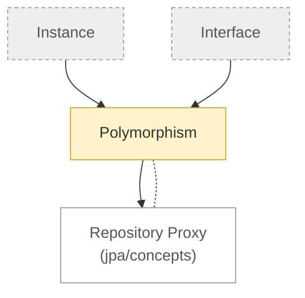

# Java Core: concepts

<!-- map:start -->
_Sơ đồ tự sinh từ link trong các note, đừng sửa tay: `node tools/notes.js map`._

<!-- map:end -->

Kiến thức nền của Java, chưa dính framework.

1. [Interface](interface.md): stub
2. [Instance](instance.md): stub
3. [Polymorphism](polymorphism.md)
