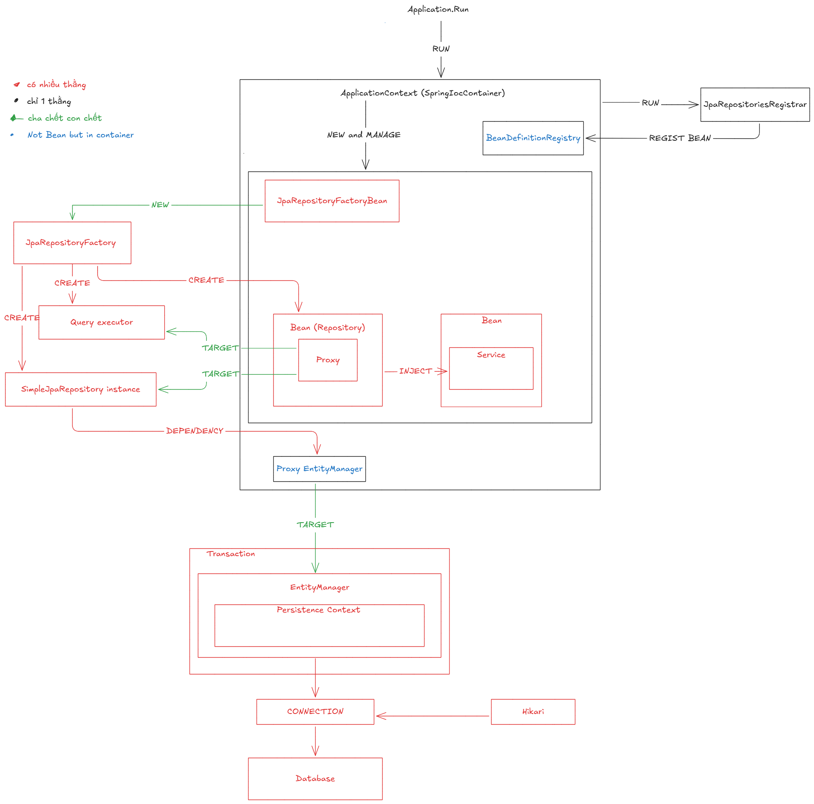

**Một câu:** Transaction chứa EntityManager, EntityManager chứa Persistence Context, cha chết thì con chết theo.

## Bản vẽ

## Các quan hệ
| Quan hệ | Giữa | Ghi chú |
|---|---|---|
| CHỨA (◆) | Transaction → EntityManager; EntityManager → Persistence Context | Transaction chết thì EntityManager chết; EntityManager chết thì Persistence Context chết |
| TARGET | [Shared Entity Manager](../concepts/shared-entity-manager.md) → EntityManager thật của transaction hiện tại | không phải chứa: EntityManager thật sinh/chết theo transaction, proxy chỉ chuyển tiếp |
| GIỮ QUA CONSTRUCTOR | SimpleJpaRepository → EntityManager | cầu nối từ tầng Repository xuống tầng này |
| DÙNG / CẤP | EntityManager dùng CONNECTION; HikariCP cấp CONNECTION; CONNECTION tới Database | mỗi transaction mượn một CONNECTION rồi trả lại pool |

## Liên kết
- **Nền:** [Entity Manager](../concepts/entity-manager.md) · [Persistence Context](../concepts/persistence-context.md)
- **Bên trên:** [Repository to Database](../../spring/data/jpa/architecture/repository-to-database.md)
- **Flow:** [Entity Lifecycle](../flow/entity-lifecycle.md)
