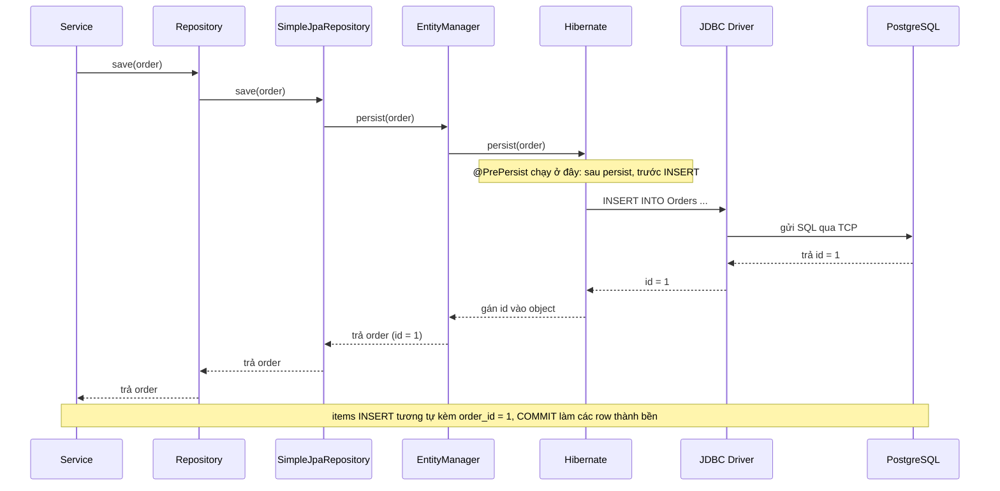

**Một câu:** Một lệnh lưu đi qua các tầng Service → Repository → SimpleJpaRepository → EntityManager → Hibernate → JDBC Driver → PostgreSQL rồi quay ngược lại.

## Giải thích
- Chiều đọc đi ngược qua cùng các tầng: PostgreSQL trả rows → JDBC Driver → Hibernate ráp rows thành entity → EntityManager → Repository → Service → Mapper chuyển thành DTO.
- `@PrePersist` chạy ở tầng Hibernate, sau persist và trước INSERT, nên `createdAt` đã có giá trị trước khi vào câu INSERT (không phải database tự sinh).
- Với id IDENTITY, INSERT chạy ngay lúc persist (để lấy id), không đợi flush hay commit. Commit chỉ làm row thành bền.
- Chỉ kể các BƯỚC mà không kể các TẦNG (hoặc ngược lại) là thiếu, cần cả hai lát cắt.

## Liên kết
- **Nền:** [Entity to Row](../concepts/entity-to-row.md) · [Entity Manager](../concepts/entity-manager.md)
- **Bên trên:** [Repository Dispatch](../../spring/data/jpa/flow/repository-dispatch.md)
- **Sâu hơn:** [Flush and Dirty Checking](flush-and-dirty-checking.md)
