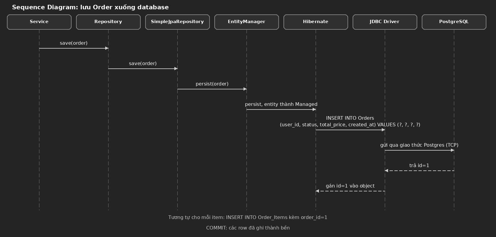

# Entity object thành row trên bảng (theo tầng)

Trạng thái: bản nháp — đang viết cùng user, chưa chốt.
Loại sơ đồ cho chủ đề này: Sequence Diagram.

## Câu chốt

Bảng không bao giờ chứa object. Hibernate tháo object ra thành giá trị phẳng: tham chiếu thành
id khóa ngoại, list thành bảng riêng, chỉ field đơn (chuỗi, số, ngày) mới thành cột.

## Vì sao cần lớp dịch này

Code làm việc với object (tham chiếu, list); database chỉ biết row và cột. Không có lớp dịch
ở giữa thì code phải tự viết SQL và tự ráp row thành object cho mọi chỗ — vừa lặp lại vừa
dễ sai. Hibernate là lớp dịch đó.

## Cơ chế: lệnh đi qua 6 tầng (chiều lưu)



### @PrePersist chạy ở đâu

Ở tầng Hibernate, sau khi persist được gọi và trước khi INSERT được sinh ra — vì vậy
createdAt đã có giá trị rồi mới đưa vào câu INSERT (không phải database tự sinh).

### Chiều ngược: đọc

Chiều đọc đi ngược lại qua cùng 6 tầng: PostgreSQL trả rows → JDBC Driver → Hibernate ráp
rows thành entity → EntityManager → Repository → Service → Mapper chuyển thành DTO, trả JSON.

## Ví dụ từ project study: Order

Object trong RAM:

```
id=null, user=User{...}, items=[Item, Item],
status="PENDING", totalPrice=250.0
```

Row trên bảng Orders sau khi lưu:

```
id=1 | user_id=uuid | status='PENDING' | total_price=250.0 | created_at=...
```

Items không nằm trong row của Order — mỗi item thành 1 row riêng ở Order_Items, kèm order_id=1.

## Bẫy

- Chỉ kể các BƯỚC mà không kể các TẦNG (hoặc ngược lại) rồi gọi là "toàn bộ" là thiếu —
  cần cả 2 lát cắt.
- Với id IDENTITY, INSERT chạy ngay lúc persist (để lấy id), không đợi flush/commit —
  commit chỉ làm cho row thành bền.
- List (orderItemList) không nằm trong row của Order — mỗi item thành row riêng ở bảng con,
  nối bằng khóa ngoại.
