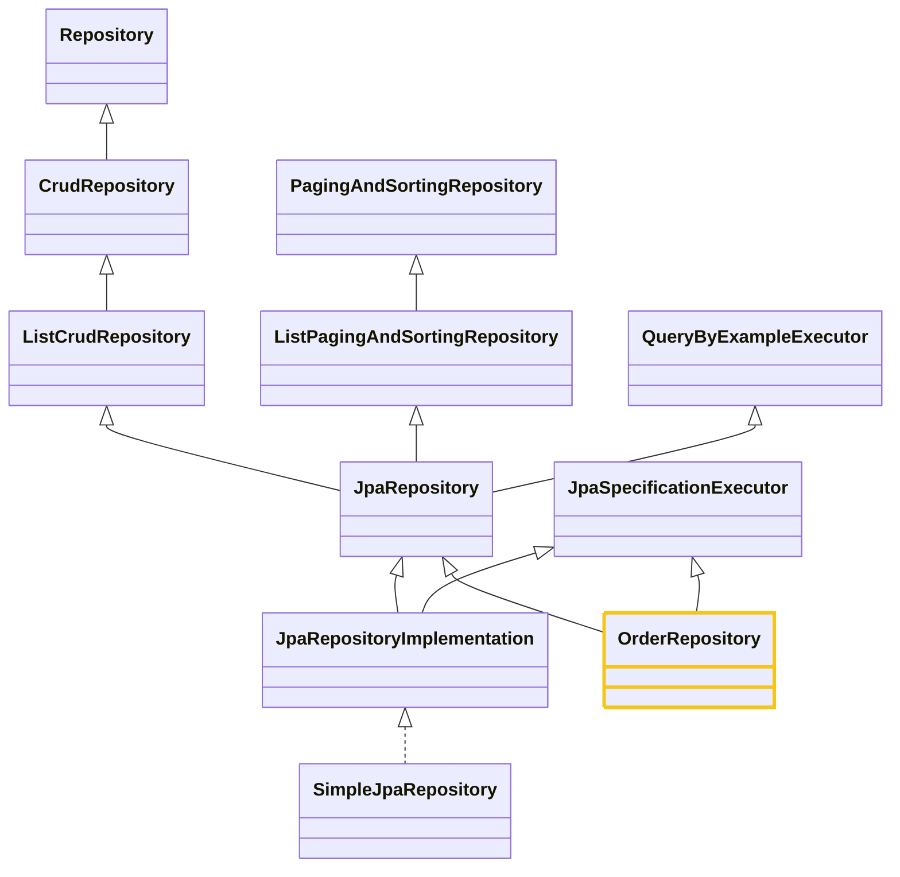

# Tầng Repository (Spring Data JPA)

Trạng thái: bản nháp — đang viết cùng user, chưa chốt.
Loại sơ đồ cho chủ đề này: Class Diagram (cây kế thừa) + sơ đồ cấu trúc tổng (bản vẽ tay của user).

## Câu chốt

Repository chỉ là interface, không có code. Spring Data tự sinh implementation
(SimpleJpaRepository) lúc chạy — bạn khai báo CẦN GÌ, framework lo LÀM NHƯ THẾ NÀO.

## Vì sao cần tầng này

Không có Repository thì mỗi chỗ cần dữ liệu phải tự viết SQL và tự ráp row thành object —
lặp lại và dễ sai. Repository gom mọi truy vấn của một entity vào một chỗ, gọi bằng tên
method thay vì viết SQL.

## Cấu trúc: cây kế thừa (Spring Data JPA 4.1.1, kiểm chứng bằng javap)

OrderRepository của bạn extends 2 interface: JpaRepository<Order, Long> và
JpaSpecificationExecutor<Order>. JpaRepository 4.1.1 KHÔNG kèm Specification — vì vậy muốn
dùng Specification phải extends thêm JpaSpecificationExecutor (như OrderRepository đã làm).

Bean Repository thực chất là proxy do Spring Data tạo, chuyển việc chuẩn cho
SimpleJpaRepository — class này giữ EntityManager, nối tầng Repository xuống tầng tiếp theo.

SimpleJpaRepository chỉ được new, không phải inject: JpaRepositoryFactory gọi new
SimpleJpaRepository(thông tin entity, entityManager) lúc app chạy. "Inject" chỉ dùng khi
Spring đưa một bean vào chỗ bạn xin nó (như proxy OrderRepository inject vào service) —
Simple thì bạn không bao giờ xin hay nhận. Chỗ duy nhất có inject ở đây là EntityManager
(Spring đưa nó vào factory, rồi factory đưa nó vào câu new).

Bean được Spring cầm đi inject CHÍNH LÀ proxy — SimpleJpaRepository instance nằm bên
trong proxy (làm target), đi kèm với proxy chứ không phải bean riêng. Spring chỉ biết
tới proxy, không biết tới Simple.

## Flow

Khởi động: Application.Run tạo ApplicationContext → JpaRepositoriesRegistrar quét package
repository, ghi bean definition vào BeanDefinitionRegistry → context tạo
JpaRepositoryFactoryBean → FactoryBean new JpaRepositoryFactory → Factory tạo proxy +
Simple + query executor → context đăng ký proxy làm bean → inject vào Service.

Proxy là cái ngã tư: mỗi method gọi tới sẽ rẽ một hướng khác nhau — method chuẩn rẽ sang
SimpleJpaRepository, method query rẽ sang bộ chạy query (suy từ tên method + annotation),
method custom rẽ sang class custom bạn tự viết (nếu có). Bản thân proxy không chứa code
làm việc thật nào.

### Quy trình tổng (user tổng kết)

factory → tạo proxy + new SimpleJpaRepository → đưa proxy cho Spring container quản lý
(giờ gọi là bean) → Spring inject bean vào nơi cần → bean hoạt động bằng cách điều hướng
đến các target mà factory tạo ở trong (SimpleJpaRepository cho method chuẩn, bộ chạy query
cho method query).

## Ví dụ từ project study: OrderRepository

- Kế thừa từ JpaRepository: save, findById, findAll, ...
- Kế thừa từ JpaSpecificationExecutor: findAll(Spec), findOne(Spec), ...
- Tự khai báo: findWithDetailsById (@EntityGraph) — lấy đơn kèm đồ thị.

## Bẫy

- Tưởng Repository có code để đọc — không có, code thật nằm ở SimpleJpaRepository.
- JpaRepository 4.x không kèm Specification — cần Specification thì extends thêm
  JpaSpecificationExecutor.

## Tóm gọn của user

Bản vẽ dưới đây là bản gốc user tự vẽ (bản cuối — thay bản Factory/Proxy/Bean trước đó).
Phần lời đã sắp lại theo logic đúng (đích inject là Service, target nằm trong proxy,
factory tạo cả 3 thứ).

Quy trình user tổng kết:

0. Khởi động: Application.Run tạo ApplicationContext → JpaRepositoriesRegistrar quét
   package, ghi bean definition vào BeanDefinitionRegistry → context tạo
   JpaRepositoryFactoryBean.
1. FactoryBean new JpaRepositoryFactory; Factory tạo proxy + new SimpleJpaRepository +
   tạo query executor cho mỗi method tự khai báo.
2. Factory đưa proxy cho Spring container quản lý — giờ gọi là bean (proxy chính là
   bean; Simple và query executor nằm bên trong proxy, không phải bean riêng).
3. Spring inject bean (proxy) vào Service là chỗ khai báo cần Repository — bean này
   chính là Repository, không phải inject vào Repository.
4. Bean hoạt động bằng cách điều hướng: method chuẩn → SimpleJpaRepository, method
   query → query executor.

Sơ đồ đi tiếp xuống tầng EntityManager (Proxy EntityManager → Transaction →
EntityManager → Persistence Context → CONNECTION → Hikari → Database) — chi tiết ở
note 03.
